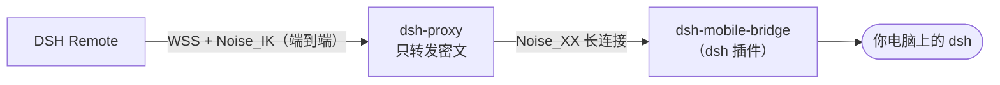
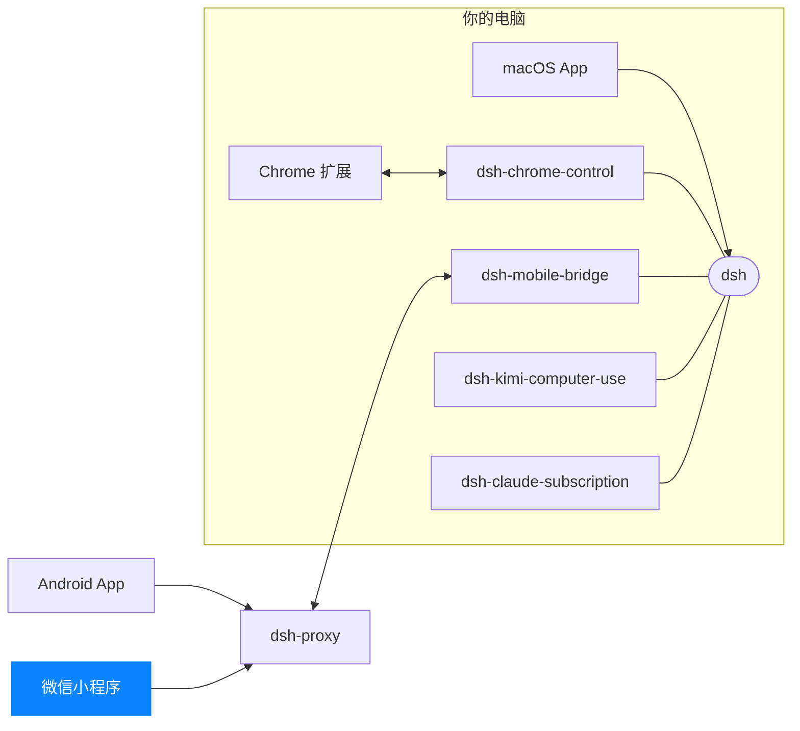

<p align="center">
  
</p>

<h1 align="center">DSH Remote · 微信小程序</h1>

<p align="center">
  <b>微信里扫一扫，就能接管电脑上的 DSH</b><br>
  不用装 App · iPhone 与 Android 都能用 · 和 Android App 同一套配对 · 全程端到端加密
</p>

<p align="center">
  
  
  
  
</p>

<p align="center">
  <a href="https://dshapp.github.io/products/miniapp/">产品介绍</a> ·
  <a href="https://dshapp.github.io/docs/install-miniapp/">安装说明</a> ·
  <a href="https://dshapp.github.io/docs/pairing/">配对与设备管理</a> ·
  <a href="https://dshapp.github.io/docs/crypto/">加密与安全模型</a>
</p>

<p align="center">
  <br>
  <sub>用微信扫一扫，或在微信里搜索「<b>DSH Remote</b>」</sub>
</p>

DSH 的原生手机客户端只有 [Android 版](https://github.com/dshapp/dsh-androidapp)。用 iPhone，或者就是不想装 App？
**DSH Remote 把同样的能力装进了微信**：打开就能看进度、批准请求、回答提问、追加指令——连的是你电脑上**同一个** DSH，同一批会话、同一份文件。

## 亮点

- **不用装 App** —— 微信扫码或搜索即可打开，没有安装包、不用开「未知来源」，iPhone 也能用。
- **同一套配对** —— 和 Android App 扫的是同一个二维码：[Mac App](https://github.com/dshapp/dsh-macapp) 侧栏「移动端访问」或 dsh web 的 `/mobileaccess`。
- **端到端加密** —— 经 WSS 连到中转，里面跑的是和电脑之间的 Noise_IK 会话；中转只拆帧转发，读不到内容。
- **功能齐全** —— 按工作区分组的会话列表，置顶、重命名、Fork、归档与恢复；实时转写、工具调用、每轮改动与 diff；审批与提问；新建会话、发消息与附件、插话；后台任务、自动化任务、插件与模型管理。
- **平板与横屏** —— 宽屏下会话列表与详情左右并排，支持 iPad 可调整窗口。
- **随时收回** —— 在电脑上吊销设备，它已有的连接立即断开。

## 三步连上

1. **电脑上装插件**：[Mac App](https://github.com/dshapp/dsh-macapp) 已内置入口；命令行用户运行 `dsh plugin --profile web add dsh-mobile-bridge`。
2. **打开配对页**：Mac App 侧栏点「移动端访问」，或在浏览器打开 dsh web 的 `/mobileaccess`。
3. **在小程序里**点「扫描二维码」（不是微信主界面的「扫一扫」），确认电脑名称后连接。没有相机时可以选「手动输入配对串」，粘贴 `dshm://` 开头的文本。



背后是 [dsh-mobile-bridge](https://github.com/dshapp/dsh-mobile-bridge)（电脑端插件）与 [dsh-proxy](https://github.com/dshapp/dsh-proxy)（公网中转），和 Android App 完全相同。

## 和 Android App 怎么选

| | [Android App](https://github.com/dshapp/dsh-androidapp) | DSH Remote |
| --- | --- | --- |
| 获取 | 下载 .apk 安装 | 微信扫码或搜索，无需安装 |
| 手机 | Android 8.0+ | iPhone 与 Android 上的微信 |
| 任务通知 | 系统推送 | 小程序内未读角标 |
| 后台连接 | 任务运行时保持连接 | 回到前台自动重连并补齐进度 |
| 设备私钥 | Android Keystore | 微信本地存储 |
| 中转 | 官方或自建 | 官方中转（受小程序合法域名限制） |

## 开发

技术栈：Taro 4 + React 18 + TypeScript + Sass CSS Modules + NutUI，图标统一用 [Lucide](https://github.com/lucide-icons/lucide)。

```bash
npm install
npm run dev:weapp       # 开发构建，产物在 dist/；用微信开发者工具打开项目根目录
npm run build:weapp     # 生产构建
npm run lint            # 类型检查
npm test                # 单元测试（逐条移植自 Android 单测，是两端行为一致的回归闸）
npm run verify:tunnel   # 加密隧道自检：crypto 向量 + 对真实 dsh-mobile-bridge 的 Noise 握手与端到端隧道
npm run preview:weapp   # 构建并生成预览二维码（miniprogram-ci）
npm run upload:weapp    # 构建并上传为体验版
```

`project.config.json` 已把 `miniprogramRoot` 指到 `dist/`，AppID 在 `.env` 的 `TARO_APP_ID`。开发者工具里需要在「详情 → 本地设置」勾选「不校验合法域名」。

| 路径 | 内容 |
| --- | --- |
| `src/pages/` | 会话列表、会话、新建、设置、配对、归档、自动化任务 |
| `src/transport/` | RPC 信封与方法表；`tunnel/` 下是纯 TS 的 Noise_IK、ChaCha20-Poly1305、X25519 与隧道内的 HTTP/1.1、WebSocket、多路复用 |
| `src/state/` | AppModel、流协调器、会话事件窗口、离线缓存与设置 |
| `src/model/` | 帧解码、转写节点、工具行、提问与审批状态机等纯逻辑（有单测） |
| `src/ui/` | 转写渲染、卡片、弹层、输入区、自定义标题栏 |
| `scripts/` | 图标子集生成、隧道自检、单元测试 |

### 与 Android 端对齐

[Android 端](https://github.com/dshapp/dsh-androidapp) 是交互与文案的权威口径，协议与线格式照 [dsh-mobile-bridge 的 PROTOCOL.md](https://github.com/dshapp/dsh-mobile-bridge/blob/main/PROTOCOL.md)。逐条对齐记录在 [`docs/`](docs/)：

- [DIFF-ANDROID.md](docs/DIFF-ANDROID.md) / [R2](docs/DIFF-ANDROID-R2.md) / [R3](docs/DIFF-ANDROID-R3.md)：三轮全量差异审计与修复进度（原始审计报告在 `docs/audit*/`）；
- [CUSTOM-NAVBAR.md](docs/CUSTOM-NAVBAR.md)：自定义标题栏，七处顶栏统一由 `ui/navBar.tsx` 绘制；
- [DSH-0.2.0](docs/DSH-0.2.0-ADAPTATION.md) / [DSH-0.2.1](docs/DSH-0.2.1-ADAPTATION.md) 适配记录；[场景测试](docs/SCENARIO-TESTS-R2.md)。

平台确实做不到的（系统推送、Keystore、把外链交给系统浏览器、TCP 不能连 1024 以下端口）在审计表里标为「平台限制」并写清原因。

### 图标

小程序画不了内联 SVG，所以 `scripts/build-icons.mjs` 从 `lucide-static` 裁出只含用到字形的 woff2 子集（约 10 KB），内联进 `styles/lucide.scss`；组件统一用 `<Icon name="check" />`，名字写错编译期报错。新增图标：把名字加进脚本的 `ICONS` 后运行 `node scripts/build-icons.mjs`（需要 `pip install fonttools brotli`）。

<!-- dsh-family:start -->
## DSH App 家族

**DSH App** 是为 [DeepSeek Harness](https://github.com/deepseek-ai/deepseek-harness)（`dsh`）打造的一组客户端与插件。它们都接入你电脑上**同一个** dsh——会话、模型与插件处处互通，按需组合即可。下载与文档见 **[dshapp.github.io](https://dshapp.github.io/)**。



| | 项目 | 做什么 | 链接 |
| --- | --- | --- | --- |
| 客户端 | **macOS App**<br>`dsh-macapp` | 原生 SwiftUI 客户端，托管本机 dsh，一站式开启各个扩展 | [介绍](https://dshapp.github.io/products/macos/) · [源码](https://github.com/dshapp/dsh-macapp) |
|  | **Android App**<br>`dsh-androidapp` | 口袋里的 DSH：审批、提问、通知，端到端加密连回电脑 | [介绍](https://dshapp.github.io/products/android/) · [源码](https://github.com/dshapp/dsh-androidapp) |
|  | **微信小程序 DSH Remote** ← 你在这里<br>`dsh-miniapp` | 免安装，iPhone / Android 的微信里扫码接管 DSH | [介绍](https://dshapp.github.io/products/miniapp/) |
|  | **Chrome 扩展**<br>`dsh-chrome-extension` | 浏览器侧栏里的 DSH 客户端，也是浏览器控制的执行端 | [介绍](https://dshapp.github.io/products/chrome/) · [源码](https://github.com/dshapp/dsh-chrome-extension) |
| dsh 插件 | **浏览器控制**<br>`dsh-chrome-control` | 把你已登录的 Chrome 作为 `mcp__chrome__*` 工具交给 Agent | [介绍](https://dshapp.github.io/products/chrome/) · [源码](https://github.com/dshapp/dsh-chrome-control) |
|  | **移动端桥接**<br>`dsh-mobile-bridge` | 经 Noise 加密隧道把 dsh 交给已配对的手机，不开端口 | [介绍](https://dshapp.github.io/products/android/) · [源码](https://github.com/dshapp/dsh-mobile-bridge) |
|  | **电脑操作**<br>`dsh-kimi-computer-use` | 让 Agent 在后台操作没有 API 的 Mac 应用 | [介绍](https://dshapp.github.io/products/cu/) · [源码](https://github.com/dshapp/dsh-kimi-computer-use) |
|  | **Claude 订阅**<br>`dsh-claude-subscription` | 用 Claude Code 订阅在 DSH 里跑 Claude 模型，不用另买 API Key | [源码](https://github.com/dshapp/dsh-claude-subscription) |
| 基础设施 | **中转服务**<br>`dsh-proxy` | 手机远程唯一的公网组件：单端口、只转发密文、无状态 | [介绍](https://dshapp.github.io/docs/crypto/) · [源码](https://github.com/dshapp/dsh-proxy) |
|  | **产品站**<br>`dshapp.github.io` | 下载、文档与更新日志 | [介绍](https://dshapp.github.io/) · [源码](https://github.com/dshapp/dshapp.github.io) |
<!-- dsh-family:end -->
